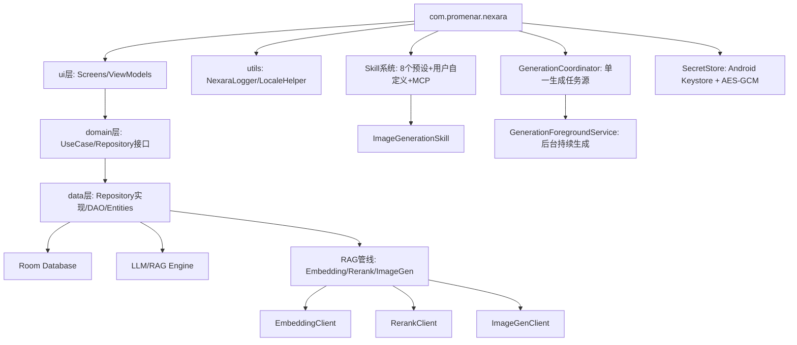

# Nexara Architecture 全景

> **最后更新**: 2026-09-22
> **注意**: 本文档为快速参考。完整架构设计见 [ARCHITECTURE_DESIGN.md](./ARCHITECTURE_DESIGN.md)（理想架构 + 技术路线择优），实现进度与差距分析见 [IMPLEMENTATION_ANALYSIS.md](./IMPLEMENTATION_ANALYSIS.md)。

## 核心架构
本项目是一个基于 Kotlin/Jetpack Compose 的原生 AI 助手应用，采用了典型的 MVVM 架构。

### 模块依赖关系

### 关键组件

- **隔离脚本运行时**：`ScriptEngine` 定义语言、执行与取消契约，`QuickJsScriptEngine` 在 `ScriptRuntimeService` 的隔离 UID 中运行。`AndroidScriptProcess` 使用有界 Messenger 消息、UID 与随机调用身份连接主进程；`SupervisedScriptRuntime` 串行复用当前会话服务，每次创建全新上下文，超时、取消和资源超限时直接强退并解绑，死亡后重建。
- **脚本能力代理**：`ScriptToolRunner` 固定会话工作区及可见挂载身份，`ScriptWorkspaceGateway` 在原文件技能/仓库适配层执行读写删，`ScriptFileApprovalBroker` 提供带来源会话的文件风险审批。`ScriptHttpClient` 共用公网判定、精确局域网白名单、固定 DNS 和逐跳验证。入口读取与能力请求使用共享 4 槽 `ScriptCapabilityDispatcher`，阻塞系统 I/O 不拖住 watchdog；已进入后端的提交沿用原接口的取消与回滚边界。无数据库版本变化，白名单与写入审批配置不进入备份。

- **NexaraApplication**: 全局上下文管理与服务初始化（嵌入/重排/图像生成客户端均在此懒加载）；`onCreate()` 自动创建 `WorkSpace` 物理目录；同时持有唯一 Application 级 `ThemePreferenceStore`。
- **ThemePreferenceStore / NexaraTheme**: `ThemePreferenceStore` 是 `theme_mode` 与 `theme_color_source` 的唯一可变事实源，监听备份恢复产生的偏好变化并通过 `StateFlow` 发布；`MainActivity` 按生命周期收集后交给根 `NexaraTheme`，统一解析系统明暗、Nexara 双配色、Android 12+ 动态色及系统栏图标外观。正式 UI 只消费 `MaterialTheme.colorScheme` 与主题内注入的 `NexaraDomainColors`；Markdown、LaTeX、Mermaid、PlantUML、ECharts 与 HTML WebView 从当前主题生成 CSS/图表色板，主题变化会触发内容重建，无静态深色或 Glass 兼容桥。
- **NexaraPageLayout / NexaraSettingsSection / NexaraSearchTopBar**: 管理页面共享 Material 3 骨架。页面根统一持有 system bars 与可选 IME insets；设置区使用透明连续列表和正文对齐分隔线；搜索由调用方持有 query/active 状态，Top App Bar 只负责焦点、IME、清除、返回优先级和 reduced-motion 兼容过渡。
- **AgentHubScreen / NexaraTabHeader**: 三个主标签页（对话、资料、设置）共用 `NexaraTabHeader` 大标题页头（标题、搜索、页面操作），内容按设置页的 `NexaraSettingsSection` 分组面组织。对话页分“置顶 / 最近（5 个）/ 助手”三组：会话行点开对话；助手行在分组内就地展开（同一时间一个，`rememberSaveable` 保存），列出该助手的全部会话与“新建会话”；置顶、编辑、删除通过长按菜单，并以自定义无障碍动作向 TalkBack 暴露等价操作，助手行的展开状态写入 `stateDescription`；新对话从页头“+”选择助手。会话目录由 `SessionListViewModel` 全量加载（置顶在前、按更新时间倒序），新建、置顶、删除失败时对话页以 Snackbar 提示。原单助手会话列表页 `AgentSessionsScreen` 及 `session_list/{agentId}` 路由已移除。
- **NexaraMotion / NexaraNavigationHeader / FolderEntriesList**: `ui/theme/Motion.kt` 定义全站动效基准：层级导航用共享 X 轴（`sharedAxisX`、按深度选方向的 `hierarchicalTransition`），同级替换用 `fadeThrough`，局部显隐用 `expandIn`/`shrinkOut`。`NexaraNavigationHeader` 是面板与浏览器内的二级页头（唯一返回按钮、当前标题、路径或说明、页面操作），`FolderBreadcrumbsBar` 在其上提供目录路径，根目录可经 `onExitRoot` 回到外层；`FolderEntriesList` 与 `FileTextPreviewPanel` 统一目录列表和文本预览的分组外观及状态过渡。外部文件夹（`ExternalFoldersPanel`）在一个全高 `NexaraBottomSheet` 内以管理、添加、浏览、回收区四页切换。`NexaraBottomSheet` 在调用方把 `show` 置为 false 时先执行 `sheetState.hide()` 再移除。页面路由（`NavGraph`）同样使用 `sharedAxisXEnter/Exit`。LazyColumn 内的状态与条目用 `Modifier.animateItem()`；聊天消息列表只做淡入（`placementSpec = null`），不得引入位移动画干扰生成中的跟随滚动。生成中的活动栏（流光状态文字、工具轮次、调用数与 Token）位于 `ui/chat/GenerationActivityRow.kt`，展开在输入框浮岛顶部；有计划时并入计划面板的收起行。输入框浮岛的厚实质感与生成流光描边、AGSL 环绕光晕（API 33+）、出错红光在 `ui/chat/ComposerIsland.kt`；空会话的粒子字标在 `ui/chat/EmptyChatWordmark.kt` 与 `ui/chat/WordmarkParticles.kt`，有消息后离开组合、循环停止。排队托盘为 `ui/chat/ComposerQueueTray.kt`（契约 `ComposerQueueUiState.kt`），位于活动栏与输入区之间。首字到达前回复位置的三点波浪为 `ui/common/GenerationDots.kt`；正文新字的连续淡入与强调色退回由 `StreamRevealer.kt` 的 `streamRevealAlpha`/`streamRevealTint` 计算、在 `MarkdownText` 的阅读注解器中按字区间着色。系统关闭动画时上述效果均为静态。全应用默认点按反馈由 `ui/theme/NexaraIndication.kt` 提供（`NexaraTheme` 覆盖 `LocalIndication`），水波与状态层裁在圆角内；需要别的形状时在 `clickable` 之前 `clip` 或显式传入 `indication`。
- **MainTabScaffold / AdaptiveNavigationSurface**: 主导航按 600dp 断点切换手机 `Surface + NavigationBar + NavigationBarItem` 浮动坞与大屏 `NavigationRail`；Scaffold 内边距保证业务内容和滚动末项不进入手机导航区域，导航颜色、选中指示和标签均由 MaterialTheme 提供。
- **ChatScreenContent / AttachmentActionMenu**: 附件菜单状态由聊天内容层提升，输入栏只报告展开意图与真实按钮坐标；单一菜单作为整个聊天 `Scaffold` 的后置覆盖层，统一处理外部/顶栏/Back 关闭、退出期触摸拦截、导入期间禁用（生成中可用，附件随排队消息发出）、RTL 与受限高度滚动。首轮坐标尚未回报时使用根容器内安全位置，随后切换到实测锚点。
- **ComposerQueueStore / 插队让出**: `data/chat/queue/FileComposerQueueStore.kt` 按会话把排队消息存于 `filesDir/composer_queue/<会话 ID 的 SHA-256>/queue.json`（临时文件加原子替换，Mutex 串行、IO 调度器），图片在入队时复制到同目录 `images/`；首次从磁盘加载的非空队列标为 RESTORED 暂停，JSON 损坏时丢弃该会话队列，删除会话经 `cleanupSessionRuntimeData` 清理。出队先移入持久化的 `sending` 租约并绑定用户消息 ID，生成接受后结清并删除图片，准备阶段被拒或回滚时回到队首并暂停；重启时若绑定的用户消息已在历史中则结清，避免重复发送。队列清空时暂停原因随之清除。`ChatViewModel` 在当前会话的生成以 COMPLETED 结束且未暂停时，等待 `GenerationCoordinator.awaitSessionIdle` 后发出队首（插队项优先），走与手动发送相同的准备链路；失败、用户停止、BUSY、结束时不在该会话分别暂停。插队：`ChatGenerationRuntime.shouldYieldAtRoundBoundary` 在工具批次结果落盘后、续轮 `buildContext` 之前查询本会话是否有插队项，为真时本轮按成功终态结束（不创建续写助手消息、不要求最终正文，空正文轮不写记忆与抽取），随后由队列发出插队消息开启新一轮；历史形态“助手工具调用 → 工具结果 → 用户”在 OpenAI Chat/Responses、Anthropic、Gemini/Vertex 均有请求体测试（`QueuedSteeringHistoryTest`）。入队失败的完整草稿由应用级 `ComposerDraftRecoveryStore` 保留到回到该会话。
- **斜杠命令（ui/chat/command）**: `SlashCommandCatalog` 是纯 Kotlin 命令目录，内置命令（`BuiltinSlashCommand`）与当前会话可用技能统一为 `SlashCommand`，界面 `SlashCommandPalette` 只负责展示与回调；输入框文本以 `/` 开头且第一个词尚未输入完（无空白）时在浮岛内、排队托盘之下弹出候选。发送判定优先级为内置命令名 > 同名技能 > 内置命令别名 > 普通消息，不认识的命令词按普通消息发送，只有停用、待信任、损坏的技能或扫描失败时拦下并保留草稿。技能命令的预加载链路为 `SkillSlashInvocation` → `DefaultChatGenerationRuntime.requestedSkill()`（按落库用户消息原文解析，排队、重新生成与审批续写都能还原）→ `ContextBuilderParams.requestedSkill` → 系统提示 `## Requested Skill` 段落（位于历史摘要之后、系统时间之前），内容与 `activate_skill` 共用 `SlashSkillActivation.render()`，不伪造工具调用、不改落库消息。内置命令在本机执行：`/new`、`/rename`、`/prompt`、`/compact`、`/clear`（只打开现有确认框）、`/mode`、`/tools`、`/export`（`ExportSessionUseCase` + 系统另存为）。
- **会话画布（data/canvas、ui/canvas）**: `FileCanvasStore` 把画布存于 `filesDir/session_canvases/<会话 ID 的 SHA-256>/<画布 UUID>/`（`metadata.json` 与 `<版本>.html`），单例 Mutex 串行、IO 调度器；临时文件同步后原子重命名，先写源码后写元数据，元数据即发布点，失败不发出 Flow。上限为每画布 10 版、源码 1 MiB、标题 120 字符、元数据 64 KiB；加载时逐条跳过损坏、超限或符号链接元数据。补丁按顺序应用，每条 `find` 必须恰好出现一次，任一失败整批不写盘，可选 `expected_version` 做乐观冲突检测。删除会话先写持久墓碑再清目录（经 `cleanupSessionRuntimeData`，前序清理失败仍执行）；`BranchSessionUseCase` 只复制创建消息位于分支前缀内的画布并重映射创建消息 ID，Room 失败时补偿删除文件。工具经 `SkillExecutionContext.messageId`（`ToolExecutor` 传入真实助手消息 ID，而非工具调用 ID）关联创建消息；`CanvasInvocationCards` 解析工具成功结果生成时间线卡片，`CanvasSessionHost` 负责列表、全屏 Dialog、历史快照与剪贴板。`CanvasWebView` 每页独占实例：禁网络与本地文件、拦截除主文档外的全部请求，响应头带 `Content-Security-Policy … sandbox allow-scripts` 与空 `Connection-Allowlist`；草稿桥接不用 `addJavascriptInterface`，以消息端口交给主框架，每次内容或主题变化轮换随机 `.invalid` 文档地址与令牌，导航、刷新、释放时撤销端口。只有核验为 Google 提供程序且 Chromium 主版本 ≥152 时启用脚本与桥接，否则静态预览。画布不在现有备份协议范围内。当前版本另经 `WorkspaceCanvasFiles`（共用 `WorkspaceFileTargetResolver`）镜像到会话工作区 `canvas/<标题>.html`：`read` 是无副作用私有快照，`syncFromWorkspace` 先导入外部修改为新版本再返回；写出用最后同步哈希做条件写入，发布前状态置 `NOT_WRITTEN`，无法确认目标仍为上次内容时记 `FAILED` 并保留私有版本，`metadata.json` 保存 `workspaceHash` 与 `versionSources`。分支会话保留工作区绑定，`copySession` 清空复制画布的工作区路径，首次写出取不冲突的新文件名；`BranchSessionUseCase` 以短事务规划、事务外复制画布、最终事务重验后提交。
- **会话状态面板（data/state、StateBoardRepository）**: `StateBoard.kt` 为纯逻辑字段模型（text/number/meter/list，1–20 个字段，key 以字母开头）与原子批量计算，`state_update` 的多项操作先全部校验再一次事务写入，同 key 改类型被拒绝。每次 AI 写入（定义、更新、移除）在 `state_board_versions` 存一条快照，锚定工具所属助手消息（`SkillExecutionContext.assistantMessageId`），人工编辑锚定当时最新有效消息；移除存空快照。回滚完全依赖复合消息外键级联：重新生成、删除、清空历史都落到消息删除，状态无需分别感知 UI 入口；重新生成期间待替换的旧回复由应用级仓库按会话与生成 owner 排除，失败或取消时自然恢复。同一消息最多保留 8 条快照（压缩只删中间版本）。`MessageManager` 在同一 Room 事务内捕获被删消息的快照并删除，撤销时先恢复消息再恢复快照；`BranchSessionUseCase` 在分支事务内按 `messageIdMap` 复制分支点以内的快照。`ContextBuilder` 每次构建读取当前有效状态，经 `StateBoardContext` 按 JSON 转义注入有界摘要（文本 160 字、列表前 5 项，标记截断），并记录本次请求所见版本；字段记录用户编辑版本，AI 基于更早版本的写入不能覆盖其后的人工修改，续轮新助手消息继承请求的已读版本。界面为浮岛内计划栏之后的 `StateBoardPanel`（48dp 状态条 + 底部面板编辑），时间线经 `StateBoardPresentation` 把状态工具结果显示为前后值摘要。
- **NavGraph**: 基于 Compose Navigation 的集中式路由中心；设置首页通过稳定目的地进入 Provider 管理和默认模型二级页面，既有 Provider 表单与模型管理路由保持独立。
- **ProviderListScreen**: 提供商管理列表页，展示状态摘要并提供 Overflow 编辑与删除入口。持久化数据中无法识别的历史协议必须以“协议不受支持”的禁用行可见，只允许确认删除，不提供编辑、探测、模型同步或任何网络路由。
- **ProviderFormScreen / SettingsInput / ProtocolSelector**: Provider 编辑使用无外层卡片的连续 Material 3 表单；协议以标准单选行表达，测试与保存固定在响应式底部动作区，保存是唯一 filled 主动作。密钥继续复用 `SecretField` 的掩码、短生命周期揭示和离页清理合同，测试终态语义固定在可达按钮上。
- **ProviderModelsScreen / ModelEditorSheet**: 模型管理使用稳定 key 的摘要 LazyColumn，行内只保留精确远端 ID、能力摘要和独立 Switch；名称、类型、能力、上下文、测试/取消、错误、删除及用户覆盖来源进入独立 Sheet。选中项从最新同步列表按模型 ID 派生，避免编辑已被同步移除的旧快照。
- **DefaultModelsScreen**: 四角色（摘要、图像、向量、重排）默认模型统一配置页面，直接触发持久化。
- **RAG/Search 设置表面**: Global、Search、Advanced、KG 与 Agent 检索设置共用连续 Material 3 列表/参数区视觉，但保持 `RagViewModel`、`SearchConfigViewModel` 与 `AgentEditViewModel` 三个状态所有者；可测试 Content 层只接收 receiver transform，不持有或回写过期配置快照，`RagViewModel` 以串行临界区保证状态发布与最终持久化顺序一致。
- **Domain 层**: `domain/model/`（6 文件）+ `domain/repository/`（9 接口）+ `domain/usecase/`（6 UseCase），零 Android 依赖。
- **Repository 层**: 通过领域接口隔离 Room 持久化、工作区文件操作与业务状态；测试数量和实现范围不等同于代码覆盖率，覆盖率目标按独立测量报告验收。
- **ContextBuilder**: 负责多源上下文（RAG/Web/KG/History）的异步调度、打分与 Prompt 合成，支持实时观测回调。查询只规范空白，保留技术符号、否定与实体信息；取消异常向父协程传播，阻止后续检索、模型及工具执行。所有子源接入 NexaraLogger 错误追踪。
- **MemoryManager**: 核心 RAG 检索引擎，集成 Embedding/Rerank/Hybrid Search 三阶段检索管线。embedQuery/search/rerank 全路径接入日志。对话记录按时间线注入（`MemoryTimeline`）：时间取 `start_message_id`（缺失时 `end_message_id`）对应消息的 `created_at`，经 `MessageDao.getCreatedAt` 批量读取，查不到时回退向量行 `created_at`；时间只写在注入正文的记录前缀中，不进入向量正文与 FTS。对话候选（memory 与 summary）按相似度加候选内名次线性的新近度分（`RECENCY_WEIGHT` 0.05）排序；`parseRecallTimeRange` 在问题含回顾意味且含时间表达时给出左闭右开时段，该时段内的对话记录不设阈值检索并优先入选。memory 取 `memoryLimit` 条、summary（事件）另取至多 3 条。state 行经 `latestStates` 每键取最新值并丢弃撤销值，不超过 24 条时全部注入，超过时一半按相似度、其余按更新时间选取；当前状态在无相似记录时也注入，引用类型为 `state`，不显示相似度。注入顺序为：当前时间与先后规则、当前状态、按时间先后的事件与记忆、按相关度的文档；`RagReference.occurredAt` 记录记录时间。
- **SessionStateMemory（事件与状态）**: 开关 `RagConfiguration.memoryStateExtractionEnabled`（默认关闭）经 `KgAdvancedSettings` 保存为 `memory_state_extraction` 并纳入备份白名单。生成成功且对话记忆开启、可嵌入时，`SessionStateScheduler` 排入 `session_state` 任务（id 为 `session-state-<助手消息id>`），由 `VectorizationQueue` 持久化、准入、删除屏障与中断恢复管理，失败任务按队列重试后清理不长期保留。处理器经 `KgRequestClient.extract`（独立响应解析器，用量计入同一统计）调用摘要预设模型或主模型，输入附同一助手最新的至多 40 条当前状态以复用对象与属性写法；输出 `{"event", "states"}`，最多 8 条状态，`value` 为 null 表示撤销。结果写入 `vectors`：事件为 `{"type":"summary","kind":"event"}`，状态 metadata 依次为 `type/key/subject/attribute/value`（`key` 为 NFKC、去空白、小写后以 U+001F 连接），`created_at` 等于本轮用户消息时间，同轮重写在事务内先删后写；写入前复核任务快照与两条消息的正文、父链与时间，抽取期间被编辑或移除的轮次不写回。summary/state 行与 memory 行同样跟随轮次消息可见、撤销与孤儿回收，但 `getMemoryBy*` 与 `turnChunkCount` 只计 memory 行；编辑用户消息与 `removeTurn` 删除该轮事件与状态，编辑助手消息与 `rewriteTurn` 重新排入抽取。
- **VectorizationQueue / DocumentIndexService / PendingDocumentIndexCoordinator**: 文档/记忆持久队列、候选索引事务服务与应用级补偿目标协调器。文件内容先构建隔离向量/KG 候选，事务内复核 hash+epoch 后原子切换；旧 worker 使用目标 CAS，删除通过 cancel-and-join/fence 屏障线性化。Queue 尚未接收的已提交目标可跨页面重试，并由冷启动 missing-scan 按当前文件版本与 KG 配置恢复。启动恢复只清理缺少身份或已确认文件不存在的旧版 `document` 孤儿任务，现代 `document_reference` 目标继续遵守 hash+epoch 契约。
- **WorkspaceRepository / WorkspaceDeletionTransaction**: Session root 作用域文件仓储。创建使用持续身份证明与不可覆盖的原子发布；回滚先隔离再核验归属，仅清理已证明属于该操作的节点。私有操作目录由根锁独占。永久删除把派生索引与文件记录纳入同一 Room 事务，并用稳定 tombstone 恢复物理删除的进程死亡窗口。
- **DualDatabaseRecoveryBootstrap / RecoverySnapshotStore / AndroidDualDatabaseRecoveryExecutor**: 正常 Room 和业务写入启动前识别公开 v17+v2 及内部 v17+v5 双库，用户选择后保存一致快照，在独立 working 副本迁移与映射。旧侧业务 ID 进入稳定命名空间；文件发布到受信目录的新根并绑定新物理身份，已确认归档只从认证副本读取。可信 Android 系统路径别名仅在应用根身份一致时规范化，用户子路径继续使用目录 FD 与 NOFOLLOW。journal 覆盖归档、文件发布、数据库切换及中断重试；源数据保留，终态后不回放新业务写入。
- **RagWorkspaceProvisioner / LegacyAttachmentCodec**: 恢复的全局知识库以受控系统 Session 独立浏览；多来源切换取消旧观察和搜索，默认分享保持固定知识库入口。历史附件原 payload 保留，打开时才有界读取并发布 FileProvider 只读 URI；损坏或超预算记录显示原因，内容哈希缓存最多 16 项/64 MiB。恢复中的旧索引任务保持人工重试状态，不自动重放。
- **DocEditorContentAccess / DocEditorViewModel**: 文档内容访问使用 `Editable / PerformanceProtected / MetadataOnly` 单一事实。文件大小严格超过 1 MiB 时不读取全文；已读取内容严格超过 32K 个 UTF-16 代码单元、2,000 行或单行 16K 个 UTF-16 代码单元时，仅向 Markdown 提供最多 16K 个 UTF-16 代码单元的快照，不构建全文 `BasicTextField`。完整 `content/persistedContent` 仍是复制、dirty、expected-hash CAS 保存与冲突处理的唯一数据源，预览 snippet 不得进入持久化路径。 编辑/预览/分屏使用同一 Row 内的稳定面板调用位置，模式间共同面板保留选区与内部状态；隐藏面板卸载，避免隐藏焦点树。
- **SharedFileImporter / DurableShareInbox**: SAF 与系统分享共用的逐项导入管线；UTF-8 前缀允许有限续读，全文保持严格编码验证。HTML 走有界离线正文提取，不加载脚本或远程资源；DOCX 按实际展开字节及条目数预检，PDF 输出和文本分块遵守 Unicode 与字节预算。逐项回滚、批次容量和索引回执保持一致。收件箱去重按投递来源区分：已消费指纹只拦截系统重放的同一 Intent（保存状态重建、最近任务重启），用户新的分享只与待处理请求去重；启动恢复以已消费 requestId 识别 ack 残留目录。
- **GenerationCoordinator / ChatGenerationRunner**: 应用级唯一生成任务源。初版全局只允许一个活动任务；统一处理 Provider 路由、RAG/工具循环、流式增量持久化、取消与结构化错误终态。成功、失败与取消路径必须先把终态发布到 `GenerationPresentationStore`，再结束协调器活动状态，避免 UI 因事件顺序停留在生成中。
- **MessageDocumentAttachment / PreparedPromptBudgetGate / BranchSessionUseCase**: 输入栏 TXT/Markdown 以版本化消息快照进入完整用户上下文，与知识库检索分离；最终路由 Prompt 在 Provider 网络前按稳定模型覆盖和远端目录容量执行 fail-closed 门禁：输出预留取显式 maxTokens，未设置时为模型最大输出与 32768 的较小值；仅携带完整文档的请求按 UTF-8 字节保守计量，其余与自动压缩同用 `ApproximateTokenEstimator`，两者共用 `PromptWindow.inputBudgetTokens`（窗口减输出预留与 2% 安全余量）。重试只在新回复成功后替换旧回复；导出可回传，稳定消息分支重映射历史并清空运行态与工作区身份。
- **GenerationForegroundService**: 观察 Coordinator 的同一任务状态，通过 `dataSync` 前台服务在切后台、锁屏、旋转或 Activity 重建后继续当前生成；通知可返回准确会话或停止任务。设备重启续传与多会话并行不在范围内；无人值守的轮次经下述系统触发调度器进入同一 Coordinator。
- **后台任务（data/jobs、background/jobs）**: `BackgroundJobManager` 是应用级控制器（实现 `BackgroundJobController`），记录以 JSON 存于 `noBackupFilesDir/background-jobs/records.json`（Mutex、临时文件、fsync、原子 move），不进入备份；内置进程以进程组运行，恢复身份用开机计数与 `/proc/<pid>/stat` 启动时钟核验，日志 20 MiB 单轮转，实时输出键 `job:<id>` 共用 `toolLiveOutputStore`。私有根任务由 `BackgroundWorkspace` 在根锁下复制副本并记基线哈希，结束后对基线 B、真实根 C、副本 S 三方合入，冲突写入 `jobs/<id>-conflicts/`，发布有持久恢复日志；Termux 任务用 `setsid nohup` worker 与看门狗，取消先落墓碑。侧载以执行登记表和前台服务保活，Play 只在可见期间持唤醒锁。`BackgroundJobCompletion` 按 `on_exit` 通知（`background_jobs` 通道，会话令牌深链）或向系统触发调度器提交 `JOB_EXIT` 请求。会话删除先停止任务，`cleanupSessionRuntimeData` 最终清理。
- **系统触发与定时任务（domain/trigger、data/trigger、data/schedule、background/schedule）**: `DefaultSystemTurnDispatcher` 在应用作用域等待备份启动门禁就绪后全局串行处理 `SystemTurnRequest`：同源新请求替换未开始的旧请求，其它生成、待处理确认或任何会话存在待审批时轮询排队（`SessionDao.hasPendingApproval` 轻量查询），30 分钟未开始则以 `BUSY_TIMEOUT` 跳过；已开始的轮次只有系统执行窗口被撤回时才经 `stopSource` 定向中断。`ApplicationSystemTurnRuntime` 与页面共用 `ChatStore` 载入锁和轮次准入，写入 `name=system_trigger` 的用户消息（首行 `<system_trigger …/>` 标签，`SystemTriggerMessage` 编解码，界面渲染为居中触发行），以 `GenerationInteractionMode.HEADLESS` 发起生成：工具审批写入会话 `approvalRequest`，重复调用/无限自动确认持久化到 `noBackupFilesDir`，通知点击后由既有审批接续路径在原用户轮次上恢复。`DefaultScheduledTaskController` 持有 Room v26 `scheduled_tasks`（identity hash 校验同步扩展到恢复探针），每次领取先持久化 `run_count` 与执行令牌，完成/中断只更新匹配令牌，启动时残留领取记 FAILED 不重放；`CronExpression` 为无依赖五段解析。`ForegroundScheduleTicker` 在 `ProcessLifecycleOwner` 处于 STARTED 时按最近计划时刻在应用作用域准点调用 `fire`（每次到期只尝试一次，触发独立于任务列表收集以免领取改写行时取消生成），系统排期保留为后台兜底，两路重复回调由领取令牌去重。`next_fire_at` 只表达前台节奏（固定间隔最短 1 分钟）；后台登记时刻由纯函数 `ScheduleCalculation.backgroundFireAt` 取 `max(next_fire_at, (last_fired_at ?: created_at) + 下限)`（精确 5、非精确 15 分钟，单次不受限），平台回调以 `background = true` 进入 `fire` 并在领取前检查该时刻，防止周期 Job 在窗口内提前消费前台计划；补发迟到按领取前任务行的后台时刻计算（claim 会改写 `last_fired_at`），权限变化只更新 `exactEffective` 并重新登记。固定间隔生成越过计划时刻时下一次为结束时刻加完整间隔。`once.in_minutes` 在工具执行时以设备时钟换算为本地时间存入既有 `Once` 字段，无表结构变化；夏令时回拨重复时段内的倒计时按较早偏移解析，属已知局限。`AndroidScheduleBackend` 用 JobScheduler（固定间隔首轮单次 Job、之后周期 Job）与侧载精确闹钟（`ScheduledTaskAlarmReceiver` → dataSync 前台服务），开机/更新/时区与精确权限变化广播只重排。`SystemTriggerNotifications` 使用 `agent_trigger` 通道，`AndroidSessionOpenIntentFactory` 签发一次性 24 小时会话令牌（应用私有偏好，不备份），`AppIntentRouter.ACTION_OPEN_SESSION` 校验后导航。分发清单检查确保 Play 不含精确闹钟权限。
- **SecretStore / SecretCatalog**: Android Keystore 生成不可导出的 AES-GCM 主密钥；普通偏好只保存密文、IV 与格式版本。Provider、Vertex、搜索、Embedding 和 WebDAV 凭据由稳定 SecretId 管理，UI 只持有存在性和短生命周期 reveal 内容。
- **BackupRepository / BackupPackageCodec**: 核心数据采用清单、逐项 SHA-256 和事务恢复；可在不导出密钥时独立加密整个备份，导出密钥则强制启用密码与 PBKDF2-HMAC-SHA256/AES-256-GCM。快照在配置 revision 前后复核，持续变化时失败关闭；个人及 Agent 头像路径属于设备本地数据，跨设备备份会剥离。备份根的系统别名先按父目录身份唯一匹配，再重拼到既有受信 base，保留旧 journal 的 baseIndex/fileKey 合同。恢复先验证再写入，错误密码、损坏包和越界内容不得产生部分写入。
- **ToolExecutionLedgerRepository / McpClient / SessionToolResolver**: 工具执行以 runtime id、规范化参数摘要和定义摘要组成稳定身份，注册、审批、认领、取消及恢复均以精确身份 CAS；取消后只允许一个 `CANCELLED` 终态。MCP 仅支持 HTTPS Streamable HTTP，增量 SSE 只接受首个精确响应 ID，合法 notification 可忽略，错误版本、错 ID、畸形/截断事件及行、事件、总量上限全部失败关闭。
- **ModelMetadataResolver / ModelCatalogRuntime**: 模型元数据唯一领域入口。运行时只读取仓库内固定的 models.dev 离线快照和 Nexara 精确修正，再按字段叠加 Provider 元数据与用户覆盖；精确名称、工作负载、三态能力、token 限制和来源可追踪，家族规则不得覆盖精确字段。
- **ModelSelectionUiModel / ModelSelectionListItem**: 模型选择 UI 的统一投影与渲染契约。`ModelInfo` 先把 Provider 数据和 `userEditedFields` 转换为分层 override，再调用 `ModelMetadataResolver.resolve(...)`；所有选择入口消费同一冻结投影与连续 Material 3 `ListItem`。`CHAT_ENDPOINT` 不混入一般能力集合，显式不兼容优先于生成式工作负载，未知能力不得被 UI 制造为支持。
- **MicroGraphExtractor/GraphExtractor**: 全量与 JIT 共用模型稳定 ID 路由与图校验；全量/手动候选通过 DocumentIndexService 的 hash、epoch、任务标识与删除准入事务提交。JIT 在容量 8 的串行后台队列中登记缓存及会话证据，提交前核验文档版本；缓存身份包含查询、完整片段内容、模型、提示词摘要及文本预算。
- **GraphStore / Room v23**: `kg_nodes` 以全局 `(normalized_name, type)` 唯一，名称执行 Unicode NFKC、首尾/连续空白归一和与设备语言无关的大小写折叠；类型同样归一。`kg_edges` 以有向 `(source_id, target_id, normalized_relation)` 唯一，端点外键为 RESTRICT。`kg_evidence` 单独记录实体或关系的 document/session/jit/legacy 来源、文档/会话、内容 hash、抽取任务、时间及关系的来源置信度；读取权重按当前文档/会话范围的存活证据取最大值，避免已失效来源污染排序。会话图谱抽取（`vectorization_tasks` 类型 `session_graph`）写入的 `session` 证据带 `message_id`（该轮最后一条助手消息），可见条件要求该消息存在；每轮状态由任务行（排队、进行中、失败、未完成）与按消息统计的证据推出，不另存列。关系写入同步证明端点，唯一约束与事务确保并发幂等。
- **KG 来源生命周期**: 文档/会话删除在事务内只移除对应证据，回收该来源原先涉及且已无证据的关系与实体。JIT 多文档联合推断缺少逐关系的独立来源证明，任一输入失效时保守撤销整次推断；其它独立来源保持。`kg_jit_cache_sources` 登记缓存的文档依赖，包括空图；删除文档同步失效缓存。读取通过存活证据筛选，全局图共享实体，文档/会话视图按证据过滤；源/目标索引和结构化种子查询支持后续 1–2 跳读取。
- **对话记忆生命周期（ConversationMemoryLifecycle）**: 对话记忆每轮一组向量，`start_message_id`/`end_message_id` 为该轮用户消息与助手消息；`VectorDao` 的公共可见条件要求两者都存在，删除、丢弃、回退、清空立即生效，撤销以原 id 恢复消息即恢复记忆。删除时以 `stale`/`updated_at` 标记失去所属消息的记忆，应用启动时物理删除超过 24 小时撤销窗口的部分。用过本会话对话记忆的 JIT 任务，其全部即时证据随删除或编辑撤销并回收孤立节点与边，同时清空 JIT 缓存。编辑用户消息删除该轮记忆，编辑助手正文按新正文重写。
- **记忆写入状态（TurnMemoryState）**: 每轮写入对话记忆的状态（writing / stored / failed / removed）以 JSON 存放在该轮最后一条助手消息的 `vectorization_status` 列，只经 `MessageDao.updateTurnMemoryState` / `compareAndSetTurnMemoryState` 定向改写，摘要归档的纯文本状态（`updateArchiveVectorizationStatus`）不覆盖 JSON；`updatePartial` 的整行读改写在 `MessageDao.updateWith` 事务内完成。早期纯文本值按无状态处理。写入统一经 `MessageManager.writeTurnMemory`：先记 writing，最终状态仅在仍为本次 writing 时落盘，取消时按实际片段恢复；`reconcileTurnMemory`（打开会话、撤销删除后）把没有写入在进行的 writing 按 `ConversationMemoryLifecycle.turnChunkCount` 改为 stored 或 failed。`removeTurn`/`rewriteTurn` 支撑“本轮记忆”面板的移除与重新记入；`onMessageEdited` 返回受影响各轮的新状态（编辑用户消息为 removed，助手重写失败为 failed）。检索轨迹 `RagRetrievalTrace` 记录实际执行的档位、对话记忆覆盖的会话与助手数（`RetrievalScopeResolver.stats`）以及 JIT 次数与模型。
- **检索范围（RetrievalScopeResolver）**: 会话 `RagOptions` 以 `memoryScope`/`graphScope`/`documentScope` 表达三类资源的档位，旧字段 `isGlobal` 只在新字段缺省时参与解析；`ContextBuilder` 按助手 `AgentMemoryPolicy`（保存在 `retrieval_config` 中，继承全局参数时也保留）收紧到上限。`RetrievalScopeResolver` 把档位解析为会话集合（按 `sessions.agent_id` 判定，“全部助手”排除未共享的私密助手）与文档范围（工作区根 + 显式文档与展开的文件夹，或全部已索引文档）；`VectorDao` 的范围查询、`KeywordSearcher.searchScoped` 与 `GraphRetrievalStore` 的 `visible_sessions`/`visible_docs` 都从同一解析结果取范围。
- **子代理（agent_task / SubagentLauncher / SubagentRunner）**: 内置工具 `agent_task` 在父工具协程内并行运行 1–3 个子代理，父轮取消即一并取消；子代理复用父会话模型的精确路由，每轮与每次调用前重读父会话，工具集排除 `agent_task`、`view_media` 与会话状态级工具（只读档位只保留只读工具），最多 12 步，单个子代理合计不超过 400k token，任务 token 上限按子代理数分摊，不执行自动检索；本地模型推理逐个占用。审批判定与父会话一致，需要授权时由 `SubagentApprovalBroker` 原地挂起并在应用全局弹窗（无专门预览的工具展示完整参数，批准后重新解析目标，不一致不执行），后台时发高优先级通知，10 分钟未处理以失败交回；“允许并记住”写入父会话白名单。`SubagentRunStore` 运行中只存内存，结束后写入 `noBackupFilesDir/subagents/<sha256(会话)>/<sha256(工具步骤)>.json`，进程重启后的运行中记录显示为已中断，父会话删除时随 `cleanupSessionRuntimeData` 删除；用量经账本在工具结束（含取消）后于不可取消区并入父轮助手消息的附加用量。
- **推理强度与参数方案（ModelParameterProfile / ModelAdaptedRequest / ParameterSchemeRepository）**: `resolveModelParameterProfile(协议, 远端模型 id, 接口地址)` 按模型族表给出推理控件形态（写法、档位、能否关闭、文档默认档位）及每个采样参数的 `ParamAvailability`：协议请求体没有的字段不显示不发送；文档列出的限制只在接口主机属于该厂商官方域名（含子域名；空地址取协议默认地址，Gemini/Vertex 协议视为官方）时生效——官方接口收进“不适用”分组或标“思考时不生效”并剔除，第三方中转、自建与本地接口只标“可能被忽略”并照常发送用户设置的值。推理写法只在协议能表达时提供，否则隐藏控件但采样限制照常生效。各协议 `buildRequestBody` 先经 `PromptRequest.adaptedTo`（传入协议的接口地址）剔除应剔除的采样参数并把保存的档位换成模型可发送的最近一档，再按写法写入推理字段，因此所有调用方（含子代理、摘要）统一受约束。参数解析顺序为会话 → 助手 → 模型默认（不发送）：会话 `InferenceParams.parameterSchemeId` 非空（某个方案或 `model-default`）时采样参数完全由会话决定，推理强度仍逐项回退，会话里的 `default` 推理取值表示显式模型默认。参数方案按稳定模型 id 存于 `parameter_schemes`（`SamplingValues` JSON），会话与助手编辑页共用 `ui/common/params` 编辑器：参数行点按原位展开统一的加减、直接输入与快捷值编辑区（停顿 400ms 后写入），标题旁标签标出来源与可用性；“已修改”只比较当前可编辑的参数。
- **触感反馈（NexaraHaptics / ChatStatusHapticTracker）**: 所有振动经 `ui/common/NexaraHaptics` 的事件类型（选择、步进、开关、确认、拒绝，以及状态类的等待审批、完成、失败）映射到 `View.performHapticFeedback` 常量，新常量不可用的系统回退到语义最接近的一档；不申请振动权限，系统关闭触摸振动时由系统忽略。`NexaraTheme` 按外观偏好（`haptic_enabled`、`haptic_status_enabled`，均在 `nexara_settings`，随备份迁移）提供 `LocalNexaraHaptics`，并在关闭触感时把组件内置的 `LocalHapticFeedback`（长按菜单、文本选择）替换为静默实现。开关、步进器、有刻度滑块、分段与标签切换、单选类选择（`NexaraHaptics.select`，选中项不变时不振动）、发送与停止、审批按钮与复制在公共组件或调用点触发交互振动；状态振动由 `ChatRoute` 中的 `ChatStatusHapticTracker` 判定：UI 状态快照只负责审批提醒与运行计时（新的审批请求振动一次，等待审批不计时），完成与失败只以 `ChatViewModel.generationOutcomes` 为准——终态确认后状态会在同一次收集中回到空闲，COMPLETED 可能一帧都不出现在界面上，因此 ViewModel 在终态分支按任务 ID 只发出一次结果（完成、失败、停止）；批准后运行超过 10 秒的完成、本页看到过运行的失败各振动一次，流式输出、工具步骤、主动停止、进入或切换会话都不振动；子代理审批弹窗出现时同样给出等待审批振动。
- **KG 迁移、恢复与备份**: 数据库版本链为 v18→v19（知识图谱实体与证据）→v20（`external_mounts`、`external_snapshots` 及索引）→v21（`ssh_hosts` 及别名唯一索引）→v22（`workspaces` 自选工作区登记及 `(kind, location)` 唯一索引、`sessions.workspace_id`、`agents.default_workspace_id`、`agents.user_rules` 与 `agent_rule_revisions` 规则历史）→v23（`kg_evidence.message_id` 及索引、`sessions(agent_id)` 索引）→v24（`agents` 的 Top K、惩罚项与 `reasoning_effort` 列，`parameter_schemes` 参数方案表；旧采样参数清空为模型默认）→v25（`state_board_versions` 会话状态快照表，会话外键与 `(session_id, anchor_message_id)` 复合消息外键均级联删除）；v19/v20 schema 保持冻结，双库恢复使用的 v18 合同另以冻结实体副本保持身份不随当前实体变化。双库恢复候选使用独立冻结的 v18 合同，发布后由主库执行前进迁移。设备绑定的挂载授权、SSH 配置、信任记录及凭据不进入可移植备份。v18→19 以 500 行主键游标分批迁移，SQLite 映射表承担去重与边重指向；可识别来源转换为证据，未知来源保留 legacy，不调用外部服务。历史抽取版本未知，迁移 hash 仅是数据库快照锚点，可能保留升级前已陈旧的图，成功重建后取得经过校验的版本。`workspace_files.kg_strategy` 保存已完成的建图意图，回收恢复只继承该意图，普通文件保持无 KG 抽取。双库合并隔离丢弃非工作区文档的派生 KG 并保留诊断，源数据继续恢复；常规备份排除全部 KG/证据/缓存依赖表，恢复清空派生图谱并重置完成时间。备份数据载荷 v4 为历史 v1–v3 的文件行补齐可空 `kg_strategy`；载荷 v5 纳入 `workspaces`，并为历史 v1–v4 补齐空工作区表、可空工作区引用与空用户规则；载荷 v6 纳入 `parameter_schemes`，历史 v1–v5 补空方案表并把助手与会话的采样参数恢复为模型默认，校验工作区位置格式、`(kind, location)` 唯一及会话/Agent 的工作区引用；载荷 v7 纳入 `state_board_versions`，历史 v1–v6 补空状态表，并严格校验快照字段值、消息同会话、来源与人工修改版本；规则历史属于本机派生数据，不进入备份，恢复时清空。必需表、列集合及类型仍严格校验。
- **ImageGenClient**: OpenAI-compatible 图像生成 API 客户端，支持 url/b64_json 响应格式。
- **ImageGenerationSkill**: `generate_image` 工具实现，LLM 可调用生成图片并内联展示在对话气泡中。
- **RagOmniIndicator**: 基于磨砂玻璃设计的全能检索指示器，集成在对话流中展示检索深度与进度。
- **NexaraLogger**: Debug 构建的统一脱敏日志和 Metro 事件边界；Release 入口受 `BuildConfig.DEBUG` 门禁并由 R8 精确剥离，业务源码禁止直接写平台日志或完整堆栈。
- **AgentHubScreen**: Agent 列表中枢（Super Assistant 已于 2026-05-13 清理）。

### 架构决策记录 (ADR)
- **ADR-001 (2026-05-13)**: **取消 Super Assistant 概念** — 统一 Agent 模型，移除 `isSuperAssistant` 特殊逻辑。✅ 已实施（Phase 3, 2026-05-13）。
- **ADR-002 (2026-05-14)**: **Embedding/Rerank 配置回退策略** — Rerank 专用键为空时回退到主 LLM Provider 配置；Embedding 只使用手动配置的地址或“默认模型”中选定的嵌入模型，Provider 中已有嵌入模型也不会被自动选用。未配置嵌入模型时记忆与文档检索静默跳过（检索轨迹 `unavailable`，不在回复中显示检索步骤），会话页给出一次指向“默认模型”的引导。✅ 已实施。
- **ADR-003 (2026-05-14)**: **图像生成工具设计** — 以 Skill 模式实现 `generate_image` 工具。✅ 已实施，详见 [ADR/image-generation-tool.md](./ADR/image-generation-tool.md)。
- **ADR-004 (2026-05-14；2026-07-13 落地)**: **后台生成架构** — 由应用级 `GenerationCoordinator` 承载唯一任务状态，`GenerationForegroundService` 观察同一状态并维持前台发起的 SSE 生成；UI 不复制任务。✅ 已实施，发行级设备矩阵仍待最终门禁。
- **ADR-005 (2026-05-16)**: **NexaraPageLayout 架构重构** — 迁移至 Scaffold 架构，通过局部按需应用 `imePadding` 与 `weight(1f)` 彻底解决键盘避让与测量崩溃问题。✅ 已实施。
- **ADR-006 (2026-05-16)**: **数据库架构一致性校验修复** — 修复了因 Entity 变更与 Migration 缺失导致的 Room 完整性校验崩溃。通过强制升级至 v11 并补充 `defaultValue` 确保架构闭环。✅ 已实施。
- **ADR-007 (2026-05-16)**: **RAG 知识库现代化改造** — 引入多选批处理架构与双模式 Markdown 编辑器。通过状态提升（State Hoisting）同步 FilesPanel 与屏幕级 UI，并集成 `MarkdownText` 引擎替代旧的文本高亮逻辑。✅ 已实施。
- **ADR-008 (2026-05-16)**: **RAG 可观测性增强** — 向量化/Memory/MicroGraph/KnowledgeGraph/RAG Retrieval 五条管线全部接入 NexaraLogger，消除 25+ 个静默 catch 块，实现全链路错误可追踪。✅ 已实施。
- **ADR-009 (2026-05-16)**: **提示词编辑器原子化标准化** — 全站统一使用 `UnifiedPromptEditor` (预览/编辑双模式) 替代所有异构的 `BasicTextField` 或 `FloatingTextEditor` 提示词输入框，确保交互一致性并支持 Markdown 预览。✅ 已实施。
- **ADR-010 (2026-05-16)**: **Provider 管理多路保存** — 修复 `onSave` 始终写入主提供商的致命 Bug，改为三路分发（新增额外/编辑主/编辑额外）；模型列表按 `providerId` 作用域过滤；移除自动网络拉取。✅ 已实施。
- **ADR-011 (2026-05-16)**: **模型能力数据库 2026-04 更新** — ModelSpec 新增 `maxOutputTokens`/`knowledgeCutoff` 维度；覆盖 117+ 模型，含 GPT-5 全系 / Claude Sonnet 5 / Gemini 3.1 / DeepSeek V4 / Qwen 3.6 / GLM-5.1 / Grok 4 / Gemma 4。✅ 已实施。
- **ADR-012 (2026-05-16)**: **Embedding 跨提供商配置解析架构** — 放弃基于 key-prefix 的模糊匹配，建立 `modelId -> providerId -> config` 的精确查找链路，并引入 `OnSharedPreferenceChangeListener` 实现全管线响应式配置更新。✅ 已实施。
- **ADR-013 (2026-05-18)**: **WebView 生命周期管理 — 测高 WebViewClient 前置绑定** — 修复 Compose `LaunchedEffect` 与 `AndroidView.update` 之间的时序竞态导致 WebView 高度测量失效的 P0 缺陷。✅ 已实施。
- **ADR-014 (2026-05-18)**: **工具调用系统架构移植 — 基于 Cherry-Studio 参考实现** — 引入中间件管线（`LlmMiddleware`/`LlmMiddlewareChain`）、统一 LLM 客户端（`UnifiedLlmClient`）、工具调用生命周期管理（`ToolCallLifecycleHandler`）、DSML 流式解析（`DsmlStreamParser`）、Provider 原生工具工厂（`ProviderToolFactory`）、搜索意图编排（`ToolOrchestrationPlugin`）、多模态结果压缩（`ResultSizeOptimizer`）。根治 10 项工具调用缺陷。✅ 已实施。
- **ADR-015 (2026-05-18)**: **Nexara Metro 调试桥系统 (Phase 1)** — 对标 React Native Metro Server 的非侵入、全链路、无 Socket 双端调试桥。通过 Room 审计回调、OkHttp SSE 拦截拦截器、LlmMiddleware 中间件在 DEBUG 下以结构化格式流式打印，在桌面配合 Node.js TUI 解析器实现 100% 零网络阻碍的秒级极速调试。✅ 已实施。
- **ADR-016 (2026-05-18)**: **CancellationException 传播模式与 channelFlow 生命周期规范** — 两项结构性缺陷根治：(1) 4 个协议类 `sendPromptSync` 的 `catch (e: Exception)` 捕获了 `CancellationException`，违反 Kotlin 结构化并发契约，导致 `withTimeoutOrNull` 失效。修复方案：在所有 `catch (e: Exception)` 前插入 `catch (e: CancellationException) { throw e }` 透传。(2) `UnifiedLlmClient.sendStream()` 使用 `channelFlow { ... awaitClose {} }`，底层协议流结束后 `awaitClose {}` 无限期挂起导致 Flow 永不完成，造成 `isGenerating` 卡死。修复方案：移除 `awaitClose {}`，让 `channelFlow` 在代码块结束时自然完成。同时 `ChatViewModel.generateMessage()` 添加 `try-finally` 确保任何退出路径都重置 `isGenerating`。✅ 已实施。
- **ADR-017 (2026-05-18)**: **知识图谱可视化 176+ 大数据量防崩溃与性能优化** — 彻底根治 ECharts 大数据量下悬挂边（Dangling Edges）导致的 JS 解析致命崩溃、无初始布局（`initLayout`）导致的坐标重叠斥力爆炸（NaN），以及 category 索引越界和连线模板解析异常。在 `kg_template.html` 中引入前置悬挂边安全过滤映射表、显式圆周初始布局（`circular`）、精细化的力导向参数调优（手机端 `repulsion: 120`）、安全类别降级映射与 Formatter 回调，并配合全局 try-catch 和红色报错卡片展示，实现 100% 可视化防崩溃与 3 倍以上的渲染收敛性能。✅ 已实施。
- **ADR-019 (2026-07-13)**: **工作区文件、派生索引与删除恢复采用事务候选切换** — 重索引失败保留旧结果；永久删除统一清理派生数据；稳定 tombstone 与持久队列覆盖进程死亡恢复。✅ 已实施，详见 [ADR-019](./ADR/ADR-019-transactional-workspace-indexing.md)。
- **ADR-020 (2026-07-18)**: **分层模型元数据注册中心** — 采用逐字段来源优先级、精确 ID、离线目录、三态能力与用户覆盖迁移；推理能力和 Chat endpoint 兼容性保持独立。✅ 已实施，当前候选真实 Provider 复验仍为 PENDING，详见 [ADR-020](./ADR/ADR-020-layered-model-metadata-registry.md)。
- **ADR-021 (2026-07-20)**: **会话完整文档上下文与消息分支** — TXT/Markdown 以持久快照完整进入 Prompt，路由后执行预算硬门禁；导出可回传，重试不丢旧回复，稳定消息可创建独立分支。✅ 已实施，详见 [ADR-021](./ADR/ADR-021-chat-full-context-documents-and-branching.md)。
- **ADR-022 (2026-10-02，2026-10-20 更新)**: **Agent Skills 指令包** — 两级技能目录（用户级 `/skills`、目录型工作区 `.agents/skills`）以文件为唯一事实源，`SkillCatalog` 统一扫描与启用/信任/已修改状态；`/skills` 为保留虚拟根并以 `NEXARA_SKILLS` 暴露给执行环境，技能目录写入逐次审批；System Prompt 列出名称、描述、来源与路径（上下文 2%、至多 8000 字符），`$名称` 点名必用，`activate_skill`/`read_skill_file` 按需加载；用户级技能进入备份分区。✅ 已实施，详见 [ADR-022](./ADR/ADR-022-agent-skills.md)。

### 新增关键组件 (2026-05-18 移植 & 调试桥落地)
- **UnifiedLlmClient**: 统一 LLM 调用入口，整合中间件链 + ToolCallLifecycleHandler，自动路由 Protocol。
- **LlmMiddlewareChain**: 可扩展中间件管线，支持 PRE/NORMAL/POST 三级 enforce 排序，链式包装 `transformStreamChunk`。
- **ToolCallLifecycleHandler**: 工具调用全生命周期管理（streaming→pending→complete），去重避免重复 chunk。
- **DsmlStreamParser**: DeepSeek DSML 格式 `<｜tool_calls｜>` XML 标签流式解析，支持跨 chunk 边界 + 缓冲区溢出保护。
- **ProviderToolFactory**: 7 个 Provider（OpenAI/Anthropic/Google/xAI/Hunyuan/DashScope）的原生 Web 搜索工具定义。
- **ToolOrchestrationPlugin**: 意图分析（关键词检测）+ 动态工具注入（web_search/knowledge_search/memory_search）。
- **ResultSizeOptimizer**: 多模态 MCP 结果 → 文本占位符转换，防 base64 超出消息大小限制。
- **MetroLogInterceptor**: 自定义 OkHttp 引擎拦截器，使用 Okio ForwardingSource 对流式 SSE (Server-Sent Events) API 响应进行非阻塞抓包，解析 chunk 并计算 Token CPS 速率。
- **MetroLoggingMiddleware**: 大模型中间件管线，拦截 `onRequestStart` / `onRequestEnd` 两个节点，高密度捕获大模型参数、滑窗历史消息和系统提示词。
- **Room QueryCallback Auditor**: 零侵入数据库 SQL 拦截。在 NexaraApplication 中直接挂载，捕获 Message / Session / TaskNode 表的所有底盘 SQL 操作。
- **scripts/nexara-metro-tui.js**: 零运行时依赖的 Node.js Debug 日志 TUI，支持 adb/标准输入、设备与 Tag 选择、TTY/非 TTY 输出、中文错误与稳定退出码。它是开发者观测工具，不是最终用户 CLI；Release 不包含可用的 Metro 调试链路。
- **Developer Panel**: 二级设置页面，用于导出日志 (`nexara_logs.txt`)。
- **Log Persistence**: 路径为应用私有 files 目录。
